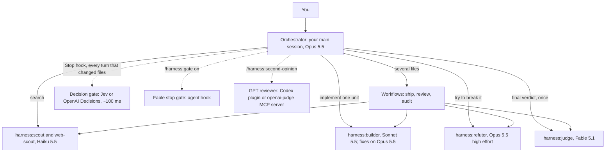

# Architecture

How the pieces fit, what enforces what, and where the limits are. Everything here maps to Claude Code features that exist as of v2.1.293 (October 2026); links to the relevant docs are at the end.

## Layers



**Layer 1, roles.** Five subagent definitions in `agents/`. Each pins a model and an effort level and restricts its tools. The orchestrator spawns them through the Agent tool, by name (`harness:scout`), or Claude picks them from their descriptions.

**Layer 2, orchestration.** Three dynamic workflow scripts in `workflows/`. A workflow is plain JavaScript executed by Claude Code's workflow runtime outside the conversation: it holds the loop, the fan-out and the intermediate results, and only the final object lands in the session. Each `agent()` call names its model, effort, agent type and output schema, so stages return typed data the script can branch on.

**Layer 3, gates.** Hooks. A `SessionStart` hook injects the delegation protocol. A `Stop` hook runs the decision gate. The Fable gate and the Codex gate are also `Stop` hooks, added per project on demand.

**Layer 4, other model families.** A bundled MCP server exposes the OpenAI Responses API as two tools (`gpt_review`, `gpt_opinion`); the decision gate talks to TypeSafe's Jev or OpenAI's Decisions API over HTTP.

**Layer 5, packaging.** All of the above is one plugin, published through a marketplace, so one install command gives every project the same setup.

## File map

```
plugins/harness/
├── .claude-plugin/plugin.json   manifest + user options (decision gate, keys, reviewer model)
├── .mcp.json                    bundled MCP server: openai-judge
├── agents/                      scout, web-scout, builder, refuter, judge
├── workflows/                   ship.js, review.js, audit.js
├── skills/                      harness (protocol), setup, gate, judge, second-opinion
├── hooks/hooks.json             SessionStart context + Stop decision gate
├── scripts/                     session-context.mjs, decision-gate.mjs, openai-judge-mcp.mjs
├── templates/                   Explore.md override, settings, Fable gate hook, CLAUDE.md snippet
├── tests/test-scripts.mjs       mock-backed tests for the scripts (no network)
└── docs/
```

## Model routing and how it is enforced

Claude Code resolves a subagent's model in this order: the per-invocation `model` parameter, then the agent definition's `model` frontmatter, then `CLAUDE_CODE_SUBAGENT_MODEL`, then the main conversation's model. The roles pin full model IDs in frontmatter (`claude-haiku-5-5`, `claude-sonnet-5-5`, `claude-opus-5-5`) so alias drift cannot move them, and the judge uses the `fable` alias, which Claude Code resolves to Fable 5.1 on the Anthropic API. The alias is deliberate: `ANTHROPIC_DEFAULT_FABLE_MODEL` remaps it, which is how users without Fable put the judge and the ship gate on Opus with one setting. Agent hooks are the exception: their `model` field does not resolve aliases (`"fable"` fails as an unrecognized model and the hook does nothing), so the Fable stop-gate template pins `claude-fable-5-1` and `/harness:gate on` substitutes the remapped model when one is set. Workflow agents follow the same order; the scripts pass the model explicitly on every stage. Workflow options arrive as `args`: an object when Claude passes one, or the raw text after the slash command. Every script reads text that is a JSON object (`/harness:ship {"task": "...", "buildModel": "claude-opus-5-5"}`) as the structured form; any other text is taken as the task, the base branch or the concern, so options written in prose are only applied if Claude turns them into an object.

Two things can still override this: an organisation `availableModels` allowlist (Claude Code substitutes and warns), and `CLAUDE_CODE_SUBAGENT_MODEL_FORCE=1`, which forces one model on everything. The harness never sets the latter.

Routing was unreliable in some Claude Code versions during 2026 (requests silently served on the parent model). The fix landed progressively through v2.1.146 to v2.1.257, which is why the install requires 2.1.293+, and why `/tasks` is the authority: it shows the model actually serving each subagent. The setup skill and the usage guide both tell people to check it.

Effort is per role too: scouts at `low`, builders at `medium` (Claude Code's default for the 5.5 models; the API default for Sonnet 5.5 is `high`), refuters and the judge at `high`. Frontmatter effort overrides the session level but not `CLAUDE_CODE_EFFORT_LEVEL`.

## The ship workflow in detail

```
Plan      Opus, high effort, read-only exploration, returns {base_branch, shared_context, units[]}
Build     per unit: Sonnet in a fresh git worktree (isolation: 'worktree'), commits on its branch,
          returns {branch, worktree_path, files_changed, checks{ran, passed, commands}}
Refute    per unit: 3 Opus refuters in parallel, lenses = correctness / edges-and-regressions / verification,
          each returns {refuted, severity, findings[], ran[]}; unit passes on majority (fewer than half refute).
          The correctness lens tests a stated rule across every input the code accepts, not only the spec's examples
Fix       once, for refuted units: the builder role on Opus (fixModel) works inside the same worktree, then Refute runs again
Integrate Opus in the main checkout: git merge --no-ff each passing branch, resolve conflicts, full suite
Gate      Fable (or the configured judge model) with the whole evidence trail: {verdict, blocking[], advisory[], verified[]}
```

Design choices worth knowing:

- Every stage looks past the request's examples. The planner writes acceptance criteria for the whole input range the changed code accepts, builders test at least one case beyond the examples, the correctness refuter checks the rule across that range (with a quick independent reference when cheap), and the gate tries a few such inputs. The benchmark showed why: on a rounding fix whose examples used whole percents, every reviewer passed code that was a cent low on fractional ones.
- Units go through Build → Refute → Fix as a pipeline, so unit B can be in review while unit A is still building. Integration is the only barrier.
- Majority rule rather than "any refuter can veto". Refuters are prompted to attack; a single over-eager objection should not sink a unit, two of three should. Dissenting findings on passing units are still surfaced to the judge and to you.
- One fix round, not a loop. If a unit cannot pass after one round, a human should look at it.
- The fix runs on Opus, not Sonnet. First builds stay on Sonnet at medium effort, where it costs well under half as much per attempt as Opus (Artificial Analysis Intelligence Index: $0.59 against $1.34 per task at medium). A refuted unit is the case where that saving did not pay off, and its retry is the last chance before the unit is dropped, so it gets the stronger model. Fixes only happen for refuted units, so the extra cost is small next to the three Opus refuters every unit already gets.
- Worktrees branch from `origin/<default>` unless `worktree.baseRef` is `head`. The recommended settings template sets `head` so a ship from a feature branch builds on that branch.
- Nothing is pushed. Integration produces merge commits on your branch; the unit branches and worktrees are kept for inspection.
- `Date.now()` and `Math.random()` are unavailable in workflow scripts by design (runs must be resumable); the scripts do not use them.

## The decision gate in detail

`scripts/decision-gate.mjs` runs on every `Stop`. It exits immediately (allowing the stop) when: it is already continuing from a stop hook (`stop_hook_active`), the plugin option is `off`, no key is configured, the turn made no edits, or anything fails. Evidence comes from the session transcript: which Edit/Write tools ran since the last user prompt, which Bash commands matched a test/build/lint pattern, which subagents were used, plus a `git status` sample. It sends the final message and that evidence to the decision model with four yes/no questions and applies thresholds in code (default 0.7, `HARNESS_GATE_THRESHOLD`). A block returns `{"decision":"block","reason":...}`, which Claude Code delivers to the model as its next instruction. The model never writes text here; it only returns probabilities.

Backends are interchangeable because the request shapes are nearly the same: TypeSafe `POST /v1/systemone` with a `questions` map of `noul` questions (also reachable through OpenRouter without a waitlist), or OpenAI `POST /v1/decisions` with a `questions` array of `predicate` questions on `gpt-6-luna`. First key found wins; `HARNESS_DECISION_PROVIDER` forces one.

## The GPT reviewer in detail

`scripts/openai-judge-mcp.mjs` is a dependency-free MCP server over stdio. `gpt_review` computes the diff (`git diff <base>...HEAD`, working tree changes, untracked files) unless one is passed, caps it at 120k characters, and calls `POST /v1/responses` with a strict JSON schema for the verdict; if the endpoint rejects the structured-output parameter it retries with plain JSON instructions. `gpt_opinion` is a free-form call. Default model `gpt-6-sol`; `gpt-6-astra` is the flagship at five times the price. The server starts without a key and only errors when a tool is called, so the plugin can stay enabled on machines without OpenAI access.

`/harness:second-opinion` prefers OpenAI's official Codex plugin when it is installed, because that route uses the user's ChatGPT subscription through the local Codex CLI and ships its own review gate.

## Known limits

- Plugin subagents cannot carry `hooks`, `mcpServers` or `permissionMode` in their frontmatter (Claude Code ignores those fields for plugin agents). That is why hooks live in `hooks/hooks.json` and the MCP server in `.mcp.json`.
- A plugin agent cannot override the built-in `Explore` subagent (plugin names are namespaced). The override is a template to copy into `~/.claude/agents/`, which `/harness:setup --explore` does.
- Pinned model IDs are Anthropic API IDs. On Bedrock, Vertex AI and Foundry the aliases map to other versions and IDs differ; copy the agents to `~/.claude/agents/` and use aliases there.
- Agent teams (lead plus peer sessions) are not used: they are experimental, interactive-only, and workflows cover the same ground with a script you can read and rerun.
- The Fable stop gate and the Codex gate are stop hooks on every turn; they are opt-in per project for cost reasons and Claude Code caps consecutive continuations at eight.
- Mods (the `agent.spawn` hook that can pick a model per spawn in code) are a possible next step for per-task routing decided by Jev; not in v1.

## Docs this is built on

- Subagents: https://code.claude.com/docs/en/sub-agents
- Model configuration: https://code.claude.com/docs/en/model-config
- Dynamic workflows: https://code.claude.com/docs/en/workflows
- Hooks reference: https://code.claude.com/docs/en/hooks
- Plugin manifest reference: https://code.claude.com/docs/en/plugins-reference
- Mods reference: https://code.claude.com/docs/en/plugins/mods/reference
- OpenAI Decisions API: https://developers.openai.com/api/docs/guides/decisions
- OpenAI Codex plugin for Claude Code: https://github.com/openai/codex-plugin-cc
- TypeSafe Jev: https://typesafe.ai/blog/introducing-system-one-models-and-jev
